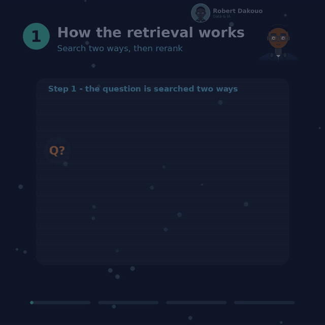
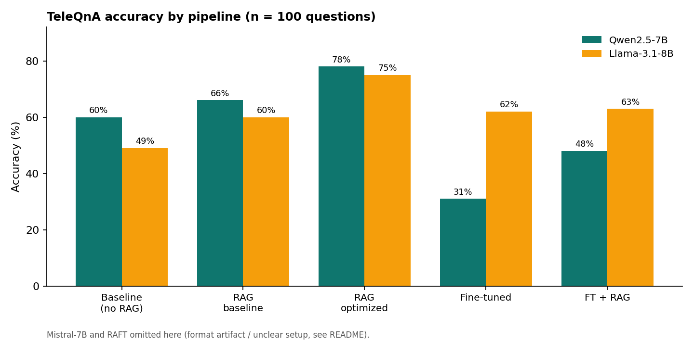
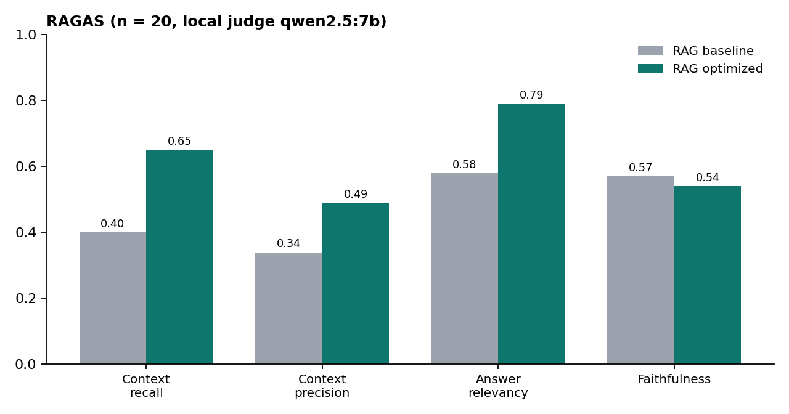
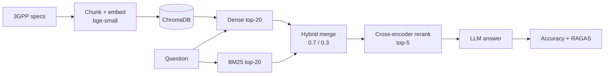

# 3GPP RAG — can retrieval and fine-tuning make small LLMs better at telecom standards?

A hands-on comparison of **RAG, hybrid retrieval + reranking, QLoRA fine-tuning, RAFT and retrieval agents** on 3GPP / 5G-NR questions, using small open models (Qwen2.5-7B, Llama-3.1-8B, Mistral-7B) that run on a single consumer GPU.

> Student project (ESMT Dakar, Data & AI). Accuracy numbers come from **100 TeleQnA multiple-choice questions** and RAGAS numbers from **20 questions** — small samples, so differences of a few points are not significant.





## Key finding
Retrieval quality is what moved the needle. Plain RAG adds 6–11 points; **hybrid retrieval (BM25 + dense) followed by cross-encoder reranking reaches 78% (Qwen2.5-7B) and 75% (Llama-3.1-8B)**, versus 60% / 49% without retrieval. RAGAS confirms the gain comes from finding better passages, not from the generator behaving differently:



| RAGAS metric (n = 20) | RAG baseline | RAG optimized |
|---|---|---|
| Context recall | 0.40 | **0.65** |
| Context precision | 0.34 | **0.49** |
| Answer relevancy | 0.58 | **0.79** |
| Faithfulness | 0.57 | 0.54 |

## Full results (accuracy, n = 100)

| Pipeline | Qwen2.5-7B | Llama-3.1-8B | Mistral-7B |
|---|---|---|---|
| Baseline (no retrieval) | 60% | 49% | 16%* |
| RAG baseline (dense, top-5) | 66% | 60% | 21%* |
| **RAG optimized (hybrid → rerank)** | **78%** | 75% | 25%* |
| QLoRA fine-tuned (no RAG) | 31% | 62% | 61% |
| Fine-tuned + RAG | 48% | 63% | 64% |
| RAFT (see note) | 6% | 44% | 54% |
| RAFT + RAG (see note) | 13% | 22% | 57% |

\* Mistral served through Ollama often does not answer in the expected "option N" format, so its low scores are largely an **output-format artifact**, not only lack of knowledge. Its fine-tuned scores are not comparable with these.

## Limitations (read before quoting any number)
- Accuracy: n = 100, single run, no confidence intervals. RAGAS: n = 20.
- RAGAS judge is the **same small local model** as the generator (`qwen2.5:7b`), so scores are noisy and slightly biased. TeleQnA is multiple-choice, so the reference is the short correct-option text, which makes context recall approximate.
- Fine-tuning / RAFT results are mixed and sometimes worse (Qwen drops to 6–31%). Likely causes are prompt-format mismatch and a small training budget; **not diagnosed yet**.
- RAFT note: the RAFT evaluation script (`src/07_raft_fast.py`) also injects retrieved context, so the difference between the "RAFT" and "RAFT + RAG" rows is not clarified. Compare them with caution.
- The "optimized" run reuses the baseline index (chunk size 500), not the 256-token setup listed in the config.
- No ablation yet (hybrid only vs rerank only vs both).

## Pipeline


## Repository layout
```
src/                 pipeline scripts (numbered in running order) + shared modules
  01_indexer_fast.py     build the ChromaDB index
  00_baseline.py         no-retrieval baseline
  02_rag_baseline.py     dense top-5 RAG
  03_rag_optimized.py    hybrid + cross-encoder rerank
  04_finetune_qlora.py   QLoRA fine-tuning (r=16, alpha=32, 4-bit nf4)
  05_evaluate_finetuned.py, 06_ft_rag.py, 07_raft_fast.py, 07b_raft_rag.py
  09_agents_eval.py, agents_core.py, agent_api.py   retrieval agents + FastAPI
  10_ragas_eval.py       RAGAS retrieval-quality evaluation (local judge)
  cache_utils.py
config.example.yaml  copy to your data folder as config.yaml and edit paths
env/                 conda setup script (Windows)
results_summary/     summary JSONs (accuracy per pipeline, RAGAS)
docs/                figures used in this README
```
Datasets, indexes, model weights and per-question outputs are **not** included.

## Reproduce
1. Create a working folder for your data (3GPP specs, TeleQnA, indexes). Copy `config.example.yaml` there as `config.yaml` and edit the paths.
2. Create the environment: `env/setup_3gpp_env.bat` (Windows) or `pip install -r requirements.txt`. Install [Ollama](https://ollama.com) and pull `qwen2.5:7b`, `llama3.1:8b`, `mistral:7b-instruct-q4_0`, `nomic-embed-text`.
3. From your data folder, run the scripts by path, in order:
   ```
   python <repo>/src/01_indexer_fast.py
   python <repo>/src/02_rag_baseline.py
   python <repo>/src/03_rag_optimized.py
   ```
   Scripts read `config.yaml` from the current folder; set `RAG_CONFIG` to use another file. `MISTRAL_LOCAL` sets the fine-tuned Mistral path used by the agents.
4. RAGAS: `python <repo>/src/10_ragas_eval.py --limit 5` (smoke test), then `--limit 20 --pipeline baseline` and `--pipeline optimized`. Expect about 1 minute per question with a local 7B judge.

Hugging Face tokens are read from local files that are git-ignored — never commit them.

## Next steps
RAGAS on 50 questions · ablation (hybrid / rerank / both) · rerun Mistral with strict output formatting · clarify RAFT vs RAFT + RAG · diagnose the fine-tuning drop.

## Author
Robert Dakouo — final-year Data & AI engineering student, ESMT Dakar. Looking for an internship (Dakar / Abidjan). Feedback welcome.

License: MIT
